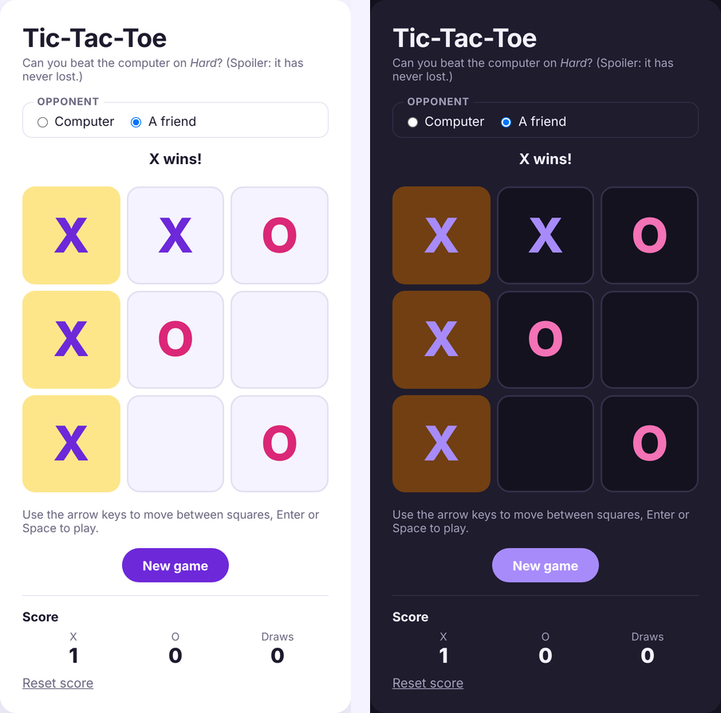

# Tic-Tac-Toe

[](../../actions/workflows/ci.yml)


**▶ Play it: https://inarazahin.github.io/tic-tac-toe/**

Tic-tac-toe in the browser, against a friend or the computer. On *Hard* the computer plays
perfectly, and that isn't just a claim: a test plays it against **every possible sequence of
opponent moves** and checks that it never loses.



## Features

- **Two modes**: against a friend on the same device, or against the computer
- **Three difficulty levels**:
  - *Easy* plays any free square
  - *Medium* takes a win and blocks yours, otherwise plays randomly (beatable with a fork)
  - *Hard* plays perfectly with [minimax](https://en.wikipedia.org/wiki/Minimax), choosing at random
    among equally good moves so games vary
- **Play as X or O**; when you choose O, the computer opens
- **Scoreboard** that survives reloads (and copes with blocked or corrupt storage)
- **Winning line highlighted**; light and dark themes follow your system setting
- **Accessible**: the board is one tab stop with arrow-key navigation (Enter or Space to play), every
  square has a spoken name like "top left, X, winning line", the status is announced to screen
  readers, and colours meet WCAG AA contrast
- **Tiny**: about 5 KB of JavaScript, no framework

## How it is built

```
src/game.ts    the rules as pure functions: no DOM, no randomness (immutable boards)
src/ai.ts      the computer player; randomness is injected, so it can be tested deterministically
src/score.ts   saved score, tolerant of missing or broken storage
src/main.ts    the DOM layer: rendering, input, keyboard navigation
```

Keeping the rules and the AI free of the DOM is what makes them easy to test exhaustively.

## Tests

```bash
npm install
```

```bash
npm test                          # 28 unit tests, under a second
```

```bash
npx playwright install chromium   # once
npm run e2e                       # 12 browser tests, each on desktop and a phone
```

### The proof that Hard never loses

`tests/unit/ai.test.ts` walks the whole game tree. At the computer's turns it follows **every** move
the AI might choose; at the opponent's turns it follows **every** legal move. That covers
**16,752 complete games** (10,640 with the computer as X, 6,112 as O). The computer wins or draws all
of them, and the check runs in about 150 ms.

### Browser tests (Playwright)

They run against the production build, on a desktop browser and an emulated phone, and find
everything by role and accessible name, the way a screen-reader user would:

- Two players: turns alternate, a row wins and is highlighted, a full board is a draw, taken
  squares and finished games ignore clicks
- Computer: the hard computer answers a corner with the centre and blocks threats; it moves first
  when you play O and the board waits for it; it punishes a mistake and the loss is counted;
  changing a setting starts a fresh game
- Accessibility: the whole game can be played with the keyboard; every square announces its
  position and contents; the layout fits a phone without sideways scrolling
- Score: survives a reload and can be reset

The hard computer chooses randomly between equally good moves. To test a specific game, one test
replaces `Math.random` in the page with a fixed value, which makes the game deterministic without
adding any test-only code to the app.

The suite was run 10 times in a row (230 test runs) without a failure.

## Run it locally

```bash
npm install && npm run dev
```

Every push to `master` runs the tests and, if they pass, publishes the site to GitHub Pages.

## History

This repository started as a C++ game built with SFML for Windows,
with the compiled DLLs committed. Version 2 is a rewrite for the browser, with the rules separated
from the interface and everything tested.
